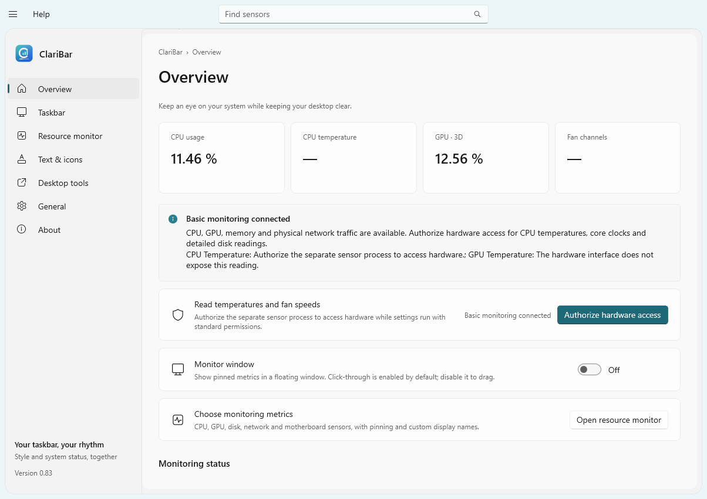
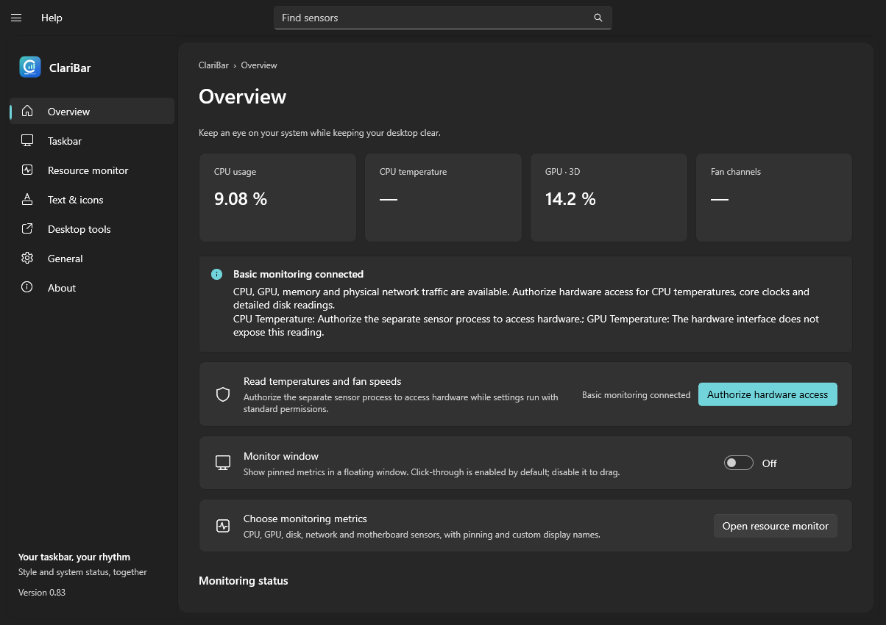
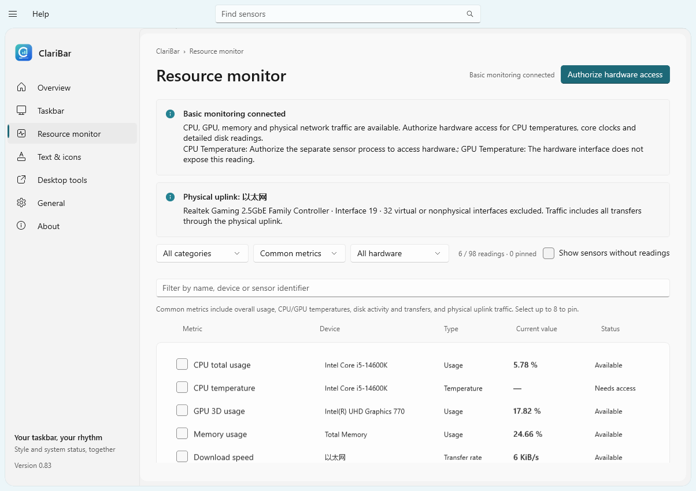
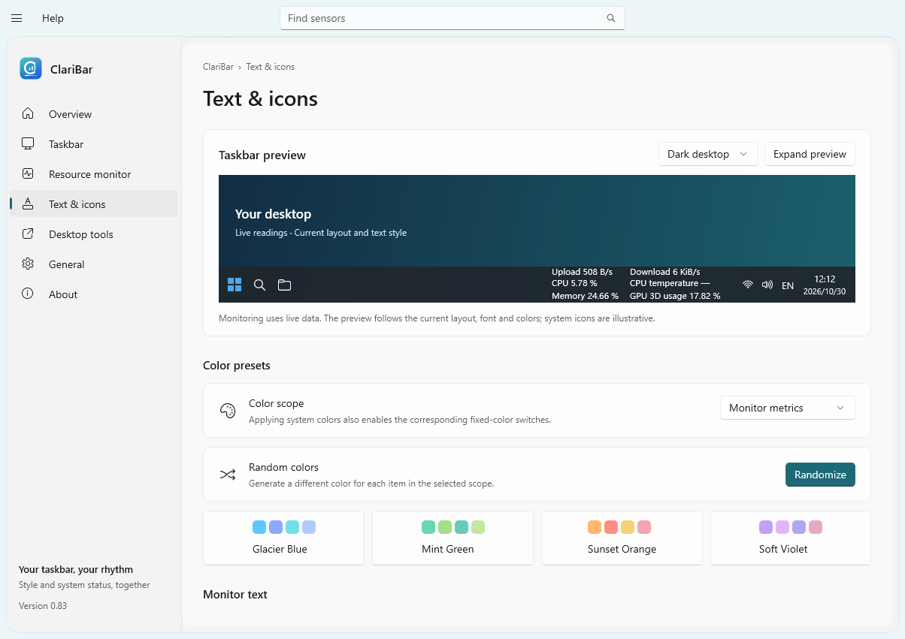
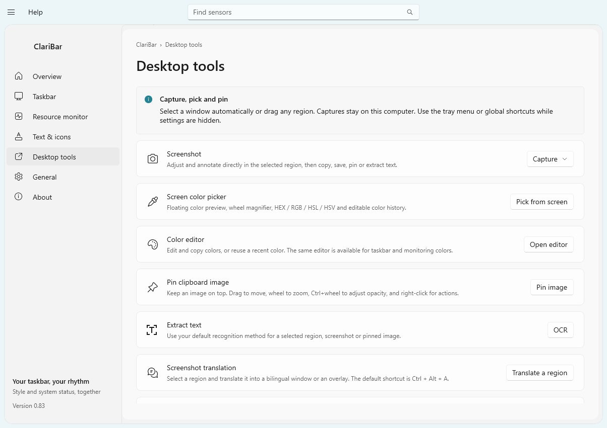
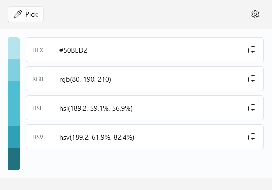
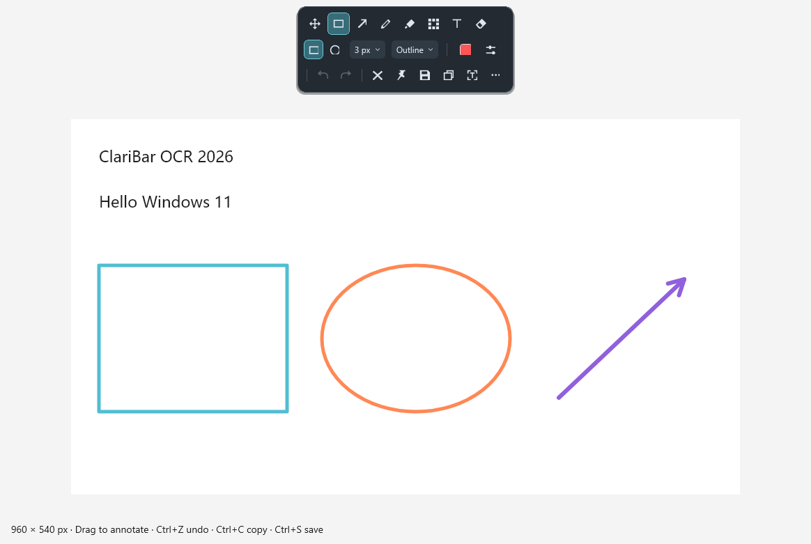
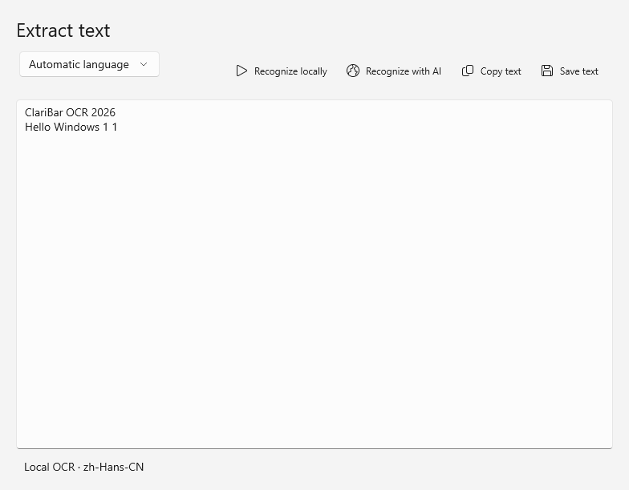
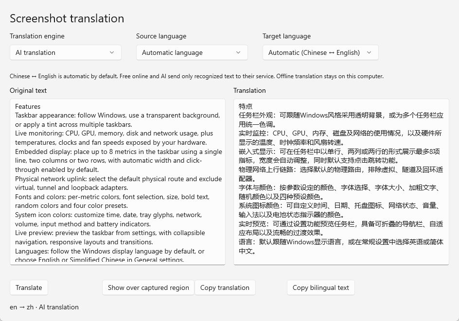
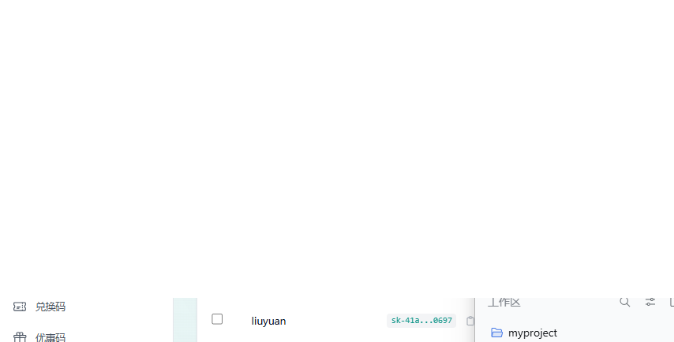

<div align="center">
  
  <h1>ClariBar</h1>
  <p>A clearer taskbar. Your system at a glance.</p>
  <p><a href="https://github.com/Adoubf/ClariBar/releases">Download</a> · <a href="https://github.com/Adoubf/ClariBar/issues">Report an issue</a> · <a href="LICENSE">MIT License</a></p>
</div>

**English** | [简体中文](README.zh-CN.md)

ClariBar is a Windows 11 taskbar customization and desktop utility. It combines a native settings-style interface with taskbar transparency, embedded resource monitoring, configurable text and system icon colors, a screen color picker, screenshots, pinned images, OCR, and screenshot translation.

**Latest release:** [ClariBar 0.83 for Windows 11 x64](https://github.com/Adoubf/ClariBar/releases/tag/v0.83).

## Screenshots

Actual application pages. Click an image to view it at full size.

| Overview · Light | Overview · Dark |
| --- | --- |
|  |  |

| Resource monitor | Text & icons |
| --- | --- |
|  |  |

| Desktop tools | Color editor |
| --- | --- |
|  |  |

| Region capture & annotation | OCR |
| --- | --- |
|  |  |

| Screenshot translation · Bilingual | Screenshot translation · Overlay |
| --- | --- |
|  |  |

## Features

- **Taskbar appearance:** follow Windows, use a transparent background, or apply a tint across multiple taskbars.
- **Live monitoring:** CPU, GPU, memory, disk and network usage, plus temperatures, clocks and fan speeds exposed by your hardware.
- **Embedded display:** place up to 8 metrics in the taskbar using a single line, two columns or two rows, with automatic width and click-through enabled by default.
- **Physical network uplink:** select the default physical route and exclude virtual, tunnel and loopback adapters.
- **Fonts and colors:** per-metric colors, font selection, size, bold text, random colors and four color presets.
- **System icon colors:** customize time, date, tray glyphs, network, volume, input method and battery indicators.
- **Live preview:** preview the taskbar from settings, with collapsible navigation, responsive layouts and transitions.
- **Languages:** follow the Windows display language by default, or choose English or Simplified Chinese in General settings.
- **Screen color picker:** pick from the live desktop with the normal mouse pointer, a following color swatch and an optional magnifier of the hovered region. Edit colors, copy HEX / RGB / HSL, explore lightness variations and revisit recent colors. The editor also applies colors to taskbar text and monitoring metrics.
- **Screenshots:** adjust a region with eight handles, detect windows or UI elements, annotate beside the selection, and use delayed capture, custom dimensions, whiteboard, cursor capture, last-region reuse and successful-capture history. Save as PNG, JPEG, BMP or WebP, with a separate Quick Save folder workflow.
- **Annotations:** rectangles, ellipses, lines, polylines, arrows, pencil, marker, mosaic, Gaussian blur, eraser and styled or rotated text, plus undo/redo and clearing. Arrows require a drag and preview the complete arrow before release; brush tools draw fresh strokes without object resize handles.
- **Pinned images:** convert clipboard images, text, basic HTML, color values or copied files into floating images. Zoom, rotate, mirror, adjust opacity, use thumbnails or click-through, organize groups, recover closed windows and restore the session after restarting. Animated GIFs support playback and frame stepping.
- **OCR and shared AI configuration:** use installed Windows OCR languages by default, or configure an OCR, VL or multimodal model through an HTTP/HTTPS service on your computer, LAN or a remote server. OCR and translation share the connection and key, with separate model IDs and a connection test.
- **Screenshot translation:** press **Ctrl + Alt + A** to select a region and show a bilingual comparison or translated text over the captured area. Chinese translates into English and English into Chinese automatically. Free online translation is the default; offline models download only after explicit opt-in. AI also supports manually chosen target languages.

## Download and install

1. Download [ClariBar-Setup-0.83-x64.exe](https://github.com/Adoubf/ClariBar/releases/download/v0.83/ClariBar-Setup-0.83-x64.exe) from [Releases](https://github.com/Adoubf/ClariBar/releases/tag/v0.83).
2. Run the installer and choose where to store the application and runtime data.
3. Start ClariBar and configure Taskbar and Resource monitor.

Requires **Windows 11 x64**. The installer includes the .NET and Windows App SDK runtimes; development tools are not needed to run the app.

Some CPU and motherboard temperatures and fan readings require hardware authorization in the app. The installer can optionally install the official PawnIO component. Upgrades preserve existing settings, and uninstalling preserves personal runtime data.

Current builds are unsigned installation previews. Each Release includes a SHA-256 checksum file; use PowerShell `Get-FileHash` to verify a download.

Version **0.83** fixes the Close button staying red after restoring settings from the tray and a deferred title-bar update during shutdown. It also includes automatic Chinese/English translation, HY-MT compatibility, more time for the first hardware scan and wrapping for offline model settings in narrow windows. Existing settings, custom shortcuts, credentials and history are preserved on upgrade.

## Quick start

1. Choose a background style in **Taskbar** and enable embedded monitoring.
2. Select and pin up to 8 metrics in **Resource monitor**.
3. Adjust layout, colors, fonts and text size in **Text & icons**, using the live preview.
4. Select a language in **General**, or leave it set to **Follow system**.
5. Closing settings keeps the app in the system tray by default. Use **Restore all** or quit from the tray menu to restore the taskbar.

Use **Help** in the toolbar for the shortcut reference, `Ctrl+B` to collapse navigation, and `Ctrl+F` to find sensors.

Desktop tools are available from settings and the tray menu. Their global shortcuts can be changed or disabled on **Desktop tools**:

| Default shortcut | Action |
| --- | --- |
| `F1` | Capture a window or region |
| `Ctrl+Alt+C` | Pick a screen color |
| `F3` | Pin an image from the clipboard |
| `Ctrl+Alt+O` | Select a region and extract text |
| `Ctrl+Alt+A` | Select a region and translate text |
| `Shift+F3` | Show or hide pinned images |
| Not assigned | Toggle mouse click-through (optional) |
| Not assigned | Delayed capture (optional) |

The capture and paste shortcuts follow Snipaste. Close Snipaste or disable its global hotkeys before switching to ClariBar with the same keys. Windows error 1409 means a shortcut is already in use; settings explain the conflict and offer **Retry shortcuts**. Leave an individual shortcut blank to disable it, or use **Use Snipaste shortcuts** to reapply the preset. Existing custom shortcuts are preserved during migration.

During capture, releasing the mouse keeps the selection open for adjustment and annotation:

| Action | Controls |
| --- | --- |
| Window / UI element detection | `Tab` before selecting |
| Move / enlarge / shrink the selection | Arrow keys / `Ctrl+arrows` / `Shift+arrows` |
| Move the cursor precisely | `W`, `A`, `S`, `D` |
| Move a region while dragging | Hold `Space` |
| Magnifier / change color format / copy color | `Alt` / `Shift` / `C` |
| Copy and finish / pin | `Enter` or double-click / `Ctrl+T` or middle-click |
| Save As / Quick Save | `Ctrl+S` / `Ctrl+Shift+S` |
| Last region / capture history | `R` / `,` and `.` |
| Show or hide annotation tools | `Space` |
| Undo / redo / clear annotations | `Ctrl+Z` / `Ctrl+Y` / `Ctrl+Shift+Z` |
| Finish the current shape / reset selection | Right-click |

On a pinned image, drag to move, wheel to zoom, `Ctrl+wheel` to change opacity, and hold `Shift` while dragging to snap to another window. Use `1` / `2` to rotate, `3` / `4` to mirror, middle-click to reset size and opacity, `Shift+double-click` for a thumbnail, and `Space` to annotate in place. For a GIF, `1` / `2` step frames and `Shift+wheel` changes playback speed. Right-click opens image actions, including printing through the Windows print dialog.

`Esc` or double-click closes a pin recoverably; paste again to recover it when the clipboard has not changed. `Shift+Esc` destroys it. Hiding all pins preserves their open state. Pin images and groups are restored at startup by default; capture and pin preferences are available on Desktop tools. Clipboard HTML uses a local renderer for common text styles, without loading web content.

When annotating a pinned image, its toolbar floats directly below the picture in a separate window. If there is insufficient room below, the toolbar moves above it. The picture and toolbar have no extra system frame; custom color and style panels can open beyond the compact toolbar. The Pin button indicates a pinned image, while Copy is an ordinary action. Closing the toolbar returns to the pinned image at its original size and position.

By default, completing a screen pick opens only the color editor. Picking again from that editor returns to the same window. Picking a color for a taskbar or monitoring setting returns to the settings page that requested it.

The color editor follows the PowerToys layout: horizontal color history, a vertical shade strip, compact HEX/RGB/HSL/HSV cards and an on-demand HSV/RGB/HEX editor. Copy values with the card buttons, right-click history colors to remove or export them, and use the gear button to choose activation behavior, mouse actions, the default copy format, or add and arrange custom color formats. Picking keeps the desktop live and preserves the mouse pointer; the color card follows it, and the wheel opens or adjusts a live magnifier of the hovered region. By default, left-click copies and opens the editor, middle-click copies and closes, and right-click cancels. The optional `Win+Shift+C` binding is supported.

Choose **Default recognition method** under **Desktop tools → Screenshots & OCR** to use local recognition or AI automatically when opening OCR from a screenshot, pinned image or shortcut. Choosing AI authorizes sending the selected image to the configured service. A new installation defaults to local recognition.

Local OCR uses Windows language components and does not download a separate model. If no OCR language is installed, add one in Windows language settings. Images and text are saved to the folder selected in Desktop tools.

Optional AI OCR supports local, LAN and remote **HTTP or HTTPS** services. Select automatic endpoint detection or one of these API formats:

| Endpoint type | Standard API suffix |
| --- | --- |
| OpenAI Chat Completions | `/v1/chat/completions` |
| OpenAI Responses | `/v1/responses` |
| Anthropic Messages | `/v1/messages` |
| Gemini GenerateContent | `/v1beta/models/{model}:generateContent` |

Enter a server root, `/v1`, `/v1beta` or a complete API endpoint; settings preview the resolved request address. Local and private network services connect directly. HTTPS uses normal certificate validation, including for an internal service.

Model IDs are freely editable. OCR models such as **PaddleOCR-VL** and **DeepSeek-OCR**, **VL models** and **general multimodal models** can connect through these APIs. Automatic model selection supplies the documented OCR prompts for PaddleOCR-VL and DeepSeek-OCR; a custom prompt and request timeout are also available. The server must support image input using the selected API format.

**Test connection** sends a built-in sample image using the current fields and displays the API/model, elapsed time and recognized text. It distinguishes successful image recognition from a connected service that returns unexpected text, and reports authentication, endpoint, network, certificate and timeout errors. Testing does not save changes; use **Save AI settings** when ready. API keys are encrypted for the current Windows account and are excluded from diagnostics.

### Screenshot translation

Press **Ctrl + Alt + A**, then click a window or drag a region. Choose the default engine and display mode under **Desktop tools → Screenshot translation**. The bilingual window shows source and translated text side by side and stacks them in a narrow window. The overlay covers the original captured region, with a nearby toolbar for viewing the original, copying the translation, closing, or returning to bilingual comparison. Switching views reuses the current result. The target defaults to **Automatic (Chinese ↔ English)**: Chinese screenshots translate into English, and English screenshots into Chinese. Each capture determines the direction again. You can choose a fixed target or enter another language for AI.

- **Free online (default):** MyMemory, no key or model download. Only recognized text is sent. Its current anonymous limit is [5,000 characters per day](https://mymemory.translated.net/doc/usagelimits.php); network and quota failures remain visible.
- **Optional offline:** Chinese ↔ English on the CPU. Enable the explicit download checkbox to install approximately 190 MB of models and an isolated runtime in the application's data/cache directories. Nothing downloads automatically. You can cancel and retry; downloaded archives are checked against pinned SHA-256 hashes.
- **AI:** add **Translation model ID** under **AI configuration**. OCR and translation share the existing server, protocol, key and timeout. Translation sends recognized text, so a regular text model is sufficient; a vision model is optional. Type a target language code or name to use languages supported by your model. Use **Test model → AI translation → Test connection** to test built-in text.

Translation first uses installed Windows OCR languages. Automatic recognition uses the installed English recognizer for English text when available. It reports missing language components or unavailable engines instead of silently switching providers.

AI translation joins wrapped screenshot lines into paragraphs before translating. **Tencent HY-MT / Hunyuan-MT** models use their [official translation prompt](https://huggingface.co/tencent/Hy-MT2-7B) with one plain-text result per paragraph. General models use structured replies, with a paragraph retry if their output merges blocks. Both approaches preserve the source positions for overlay display. Recognized source text remains visible if translation fails.

Basic command-line actions can also be sent to a running instance:

```powershell
ClariBar.exe --capture
ClariBar.exe --pick-color
ClariBar.exe --pin
ClariBar.exe --ocr
ClariBar.exe --translate
ClariBar.exe --hide-pins
ClariBar.exe --delayed-capture
ClariBar.exe --quit
```

## Versioning

Feature updates change the first decimal place (`0.7` → `0.8`). Refinements and fixes change the second (`0.71` → `0.72`). The current preview is **0.83**. `Version.props` supplies the version for the app, build scripts and installer.

## Build from source

### Requirements

- Windows 11 x64
- Visual Studio or Build Tools with Desktop development with C++ and Windows SDK 10.0.26100 or later
- .NET SDK 10.0.403 or a newer SDK in the same major version
- CMake 3.25 or later, Ninja, and Git
- For installer packaging: Inno Setup 7.1 and the official [PawnIO installer](https://github.com/namazso/PawnIO.Setup/releases)

### Build and run

```powershell
git clone https://github.com/Adoubf/ClariBar.git
cd ClariBar
.\scripts\build.ps1 -Check
.\scripts\run.ps1 -Development
```

You can also open `ClariBar.slnx` in Visual Studio. By default, build outputs, caches and artifacts use the repository’s `.build/` directory. Set `CLARIBAR_ROOT` to use another development directory. Scripts support both portable tools inside that directory and a system development environment.

### Create an installer

```powershell
.\scripts\package.ps1 -PawnIOInstaller ".\PawnIO_setup.exe"
```

The script builds the application, publishes self-contained runtimes and creates the installer. It locates Inno Setup in the development directory or a standard installation; use `-InnoCompiler` to provide a different `ISCC.exe` path. Output appears under `artifacts/ClariBar/releases/` in the development directory.

## Project structure

| Directory | Contents |
| --- | --- |
| `src/ClariBar.App` | C# / WinUI 3 settings interface |
| `src/ClariBar.Core` | Settings, models, metric selection and language resources |
| `src/ClariBar.SensorBroker` | Independent hardware sensor process |
| `src/ClariBar.Native` | Native C++ windows, system metrics and taskbar bridge |
| `src/ClariBar.ExplorerTap` | C++ / WinRT taskbar integration |
| `assets` | Branding and application screenshots |
| `installer` | Setup wizard and bootstrap |
| `scripts` | Build, packaging and verification scripts |
| `tests` | Core and taskbar integration checks |
| `licenses` | Third-party licenses |

## Compatibility

- Taskbar integration depends on Windows 11 internal controls. Windows updates and other taskbar customization tools can affect compatibility.
- Sensor availability depends on hardware, drivers and access permissions. Missing readings are never substituted with data from another sensor.
- System colors apply to supported text, glyphs and vector icons. Third-party color tray bitmaps are not recolored.
- Hardware monitoring is read-only; ClariBar does not control fan speeds, voltages or power.

## Feedback and contributions

Use the [bug report form](https://github.com/Adoubf/ClariBar/issues/new?template=01-bug-report.yml) or [feature request form](https://github.com/Adoubf/ClariBar/issues/new?template=03-feature-request.yml), or contribute a pull request. English and Chinese Issue Forms are available.

Bug reports require the ClariBar version, Windows version and build, affected feature, reproduction steps, expected behavior and actual behavior. Hardware details, display settings, screenshots and logs are optional. Remove personal paths, account information and tokens before sharing attachments.

## Author and support

**Author:** [Haoyue](https://github.com/Adoubf)

**Email:** [mosaryalex@gmail.com](mailto:mosaryalex@gmail.com)

Thank you to everyone who uses, reports issues or contributes. Contact the author by email about sponsorship. Include a publicly displayable name if you would like an acknowledgement on the app’s About page.

## License

Original ClariBar code and artwork use the [MIT License](LICENSE). Third-party components retain their respective licenses; see [THIRD-PARTY-NOTICES.md](THIRD-PARTY-NOTICES.md).
