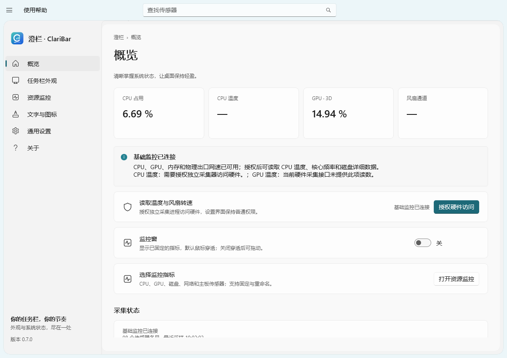
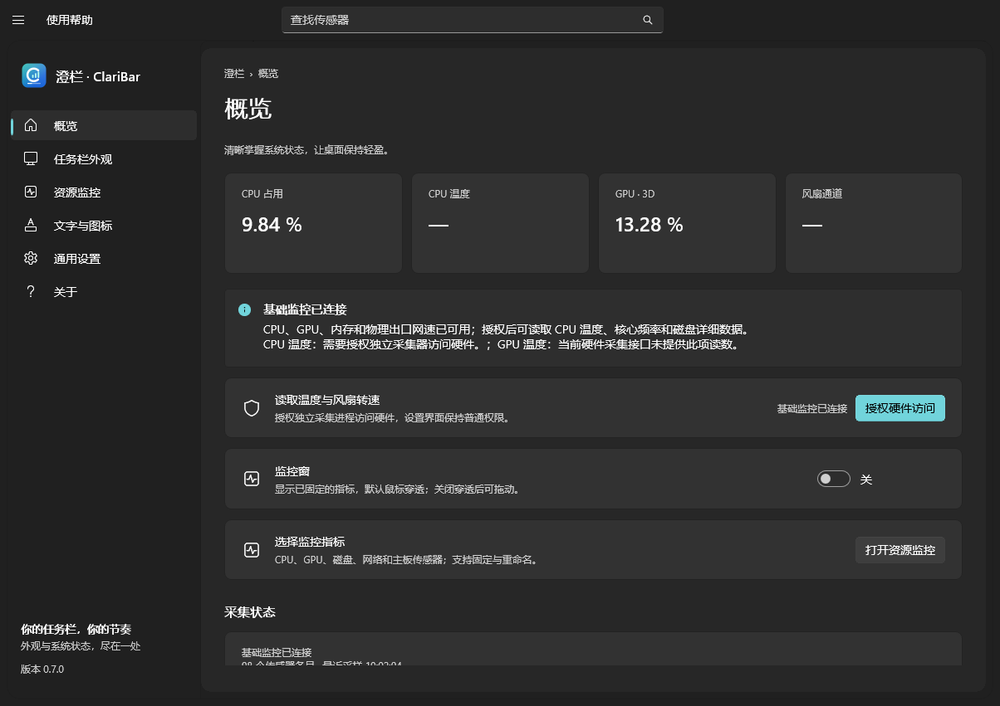
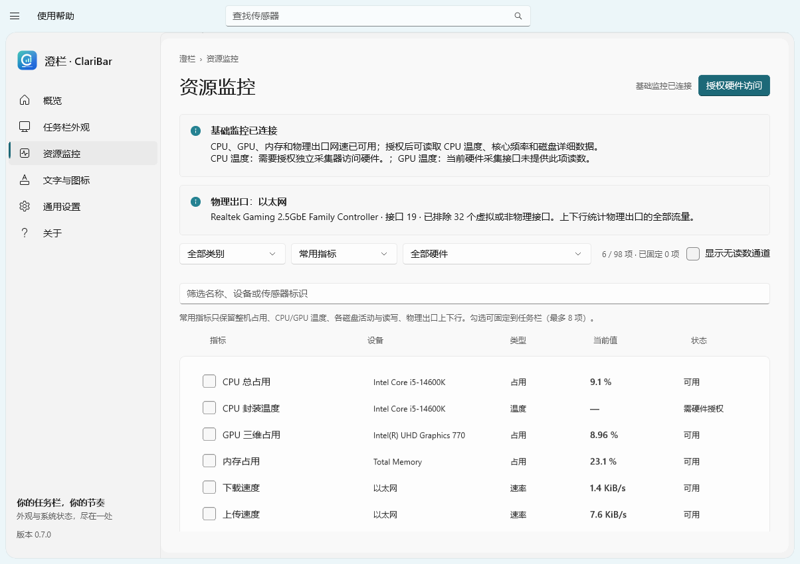
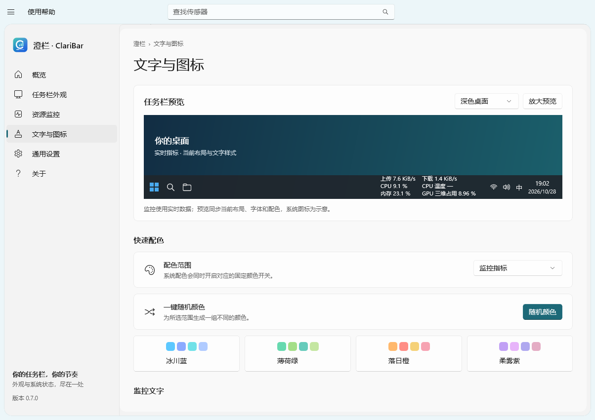

<div align="center">
  
  <h1>澄栏 · ClariBar</h1>
  <p>让 Windows 11 任务栏更通透，让系统状态一目了然。</p>
  <p><a href="https://github.com/Adoubf/ClariBar/releases">下载安装</a> · <a href="https://github.com/Adoubf/ClariBar/issues">问题反馈</a> · <a href="LICENSE">MIT 许可证</a></p>
</div>

[English](README.md) | **简体中文**

ClariBar 是一款面向 Windows 11 的任务栏美化与实时资源监控工具，提供原生设置风格的界面、任务栏透明效果、内嵌监控以及文字和系统图标配色。

## 界面展示

以下为程序实际界面，点击图片可查看大图。

| 概览 · 浅色 | 概览 · 深色 |
| --- | --- |
|  |  |

| 资源监控 | 文字与图标 |
| --- | --- |
|  |  |

## 功能

- **任务栏外观**：跟随系统、全透明或半透明着色，支持多显示器任务栏。
- **实时监控**：查看 CPU、GPU、内存、磁盘和网络状态，以及硬件支持的温度、频率和风扇转速。
- **内嵌显示**：将常用指标嵌入任务栏，支持单行、双栏和双行布局，默认自动适应文字宽度并穿透鼠标。
- **网络选择**：根据默认物理出口读取上下载速度，过滤虚拟、隧道和回环网卡。
- **文字与配色**：逐项调整颜色，选择字体、字号和加粗，提供随机配色及四套预设方案。
- **系统图标配色**：分别调整时间、日期、托盘、网络、音量、输入法和电池的文字或字形颜色。
- **实时预览**：在设置页查看任务栏效果；支持折叠导航、自适应布局和过渡动画。
- **语言切换**：默认跟随 Windows 显示语言，也可在“通用设置”手动选择 English 或简体中文。

## 下载与安装

1. 打开 [Releases](https://github.com/Adoubf/ClariBar/releases)，下载最新版本的 `ClariBar-Setup-*-x64.exe`。
2. 运行安装程序，按需选择程序和运行数据的保存位置。
3. 启动 ClariBar，在“任务栏外观”和“资源监控”中配置显示效果。

系统要求：**Windows 11 x64**。安装包自带 .NET 和 Windows App SDK 运行库，普通用户无需安装开发环境。

读取部分 CPU、主板温度和风扇数据需要在应用内授权硬件访问；安装向导可选安装官方 PawnIO 组件。升级保留已有设置，卸载保留个人运行数据。

当前版本为未签名的安装预览版。Release 同时提供 SHA-256 校验文件，可使用 PowerShell 的 `Get-FileHash` 核对下载文件。

## 使用

1. 在“任务栏外观”中选择背景样式并开启任务栏内嵌监控。
2. 在“资源监控”中筛选并固定需要显示的指标，最多支持 8 项。
3. 在“文字与图标”中调整布局、配色、字体和字号，通过预览查看效果。
4. 关闭设置窗口后，应用默认继续驻留托盘；从托盘彻底退出或点击“全部还原”可恢复系统外观。

快捷键：`F1` 打开帮助，`Ctrl+B` 折叠导航，`Ctrl+F` 查找传感器。

## 从源码构建

### 开发环境

- Windows 11 x64
- Visual Studio 或 Build Tools，安装“使用 C++ 的桌面开发”和 Windows SDK 10.0.26100 或更高版本
- .NET SDK 10.0.403 或同一主版本的更新 SDK
- CMake 3.25 或更高版本、Ninja、Git
- 打包安装程序时需要 Inno Setup 7.1，以及官方 [PawnIO 安装程序](https://github.com/namazso/PawnIO.Setup/releases)

### 构建和运行

```powershell
git clone https://github.com/Adoubf/ClariBar.git
cd ClariBar
.\scripts\build.ps1 -Check
.\scripts\run.ps1 -Development
```

也可以在 Visual Studio 中打开 `ClariBar.slnx`。默认构建、缓存和产物保存在仓库的 `.build/` 目录；设置 `CLARIBAR_ROOT` 环境变量可以使用其他目录。脚本优先使用该目录下的便携工具，也支持系统开发环境。

### 生成安装包

```powershell
.\scripts\package.ps1 -PawnIOInstaller ".\PawnIO_setup.exe"
```

脚本完成构建、自包含发布和安装包生成。Inno Setup 可位于开发目录或标准安装目录，也可通过 `-InnoCompiler` 指定 `ISCC.exe`。生成的安装包位于开发目录下的 `artifacts/ClariBar/releases/`。

## 项目结构

| 目录 | 内容 |
| --- | --- |
| `src/ClariBar.App` | C# / WinUI 3 设置界面 |
| `src/ClariBar.Core` | 配置、数据模型、指标筛选和中文标签 |
| `src/ClariBar.SensorBroker` | 独立硬件采集进程 |
| `src/ClariBar.Native` | C++ 原生窗口、系统指标和任务栏桥接 |
| `src/ClariBar.ExplorerTap` | C++ / WinRT 任务栏适配 |
| `assets/branding` | 应用图标和安装器素材 |
| `installer` | 安装向导与引导程序 |
| `scripts` | 构建、打包与验证脚本 |
| `tests` | 核心功能及任务栏集成检查 |
| `licenses` | 第三方许可证 |

## 兼容性说明

- 任务栏适配依赖 Windows 11 内部控件，Windows 更新或其他任务栏修改工具可能影响兼容性。
- 温度、频率和风扇数据取决于硬件、驱动和访问权限；没有读数的通道不会以其他传感器的数据替代。
- 系统配色覆盖支持的文字、字形和矢量图标，第三方托盘程序的彩色位图暂不重绘。
- 应用只读取硬件信息，不控制风扇转速、电压或功率。

## 反馈与贡献

欢迎通过[错误报告表单](https://github.com/Adoubf/ClariBar/issues/new?template=02-bug-report.zh-CN.yml)或[功能建议表单](https://github.com/Adoubf/ClariBar/issues/new?template=04-feature-request.zh-CN.yml)提交反馈，或通过 Pull Request 参与改进。Issue 表单同时提供英文和中文版本。

错误报告必须填写 ClariBar 版本、Windows 版本及内部版本号、受影响功能、复现步骤、预期结果与实际结果。硬件信息、显示器设置、截图和日志可选；上传前请遮挡个人路径、账号及令牌等敏感信息。

## 作者与支持

作者：**Haoyue**
邮箱：[mosaryalex@gmail.com](mailto:mosaryalex@gmail.com)

感谢每一位使用、反馈和贡献的朋友。赞助事宜请通过邮箱联系；如希望在软件关于页面署名致谢，请注明可以公开展示的名称。

## 许可证

ClariBar 原创代码和品牌素材采用 [MIT 许可证](LICENSE)。第三方组件遵循各自许可证，详见 [THIRD-PARTY-NOTICES.md](THIRD-PARTY-NOTICES.md)。
