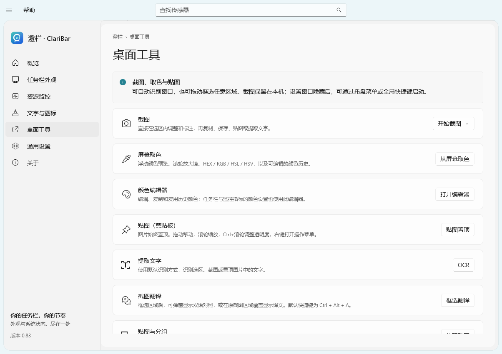
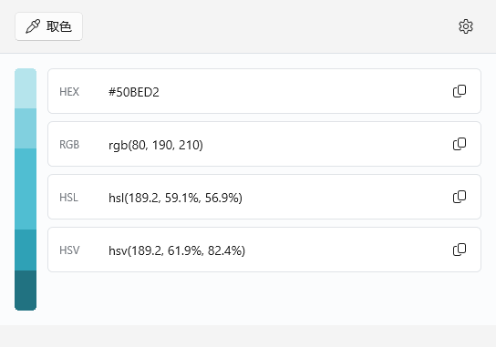
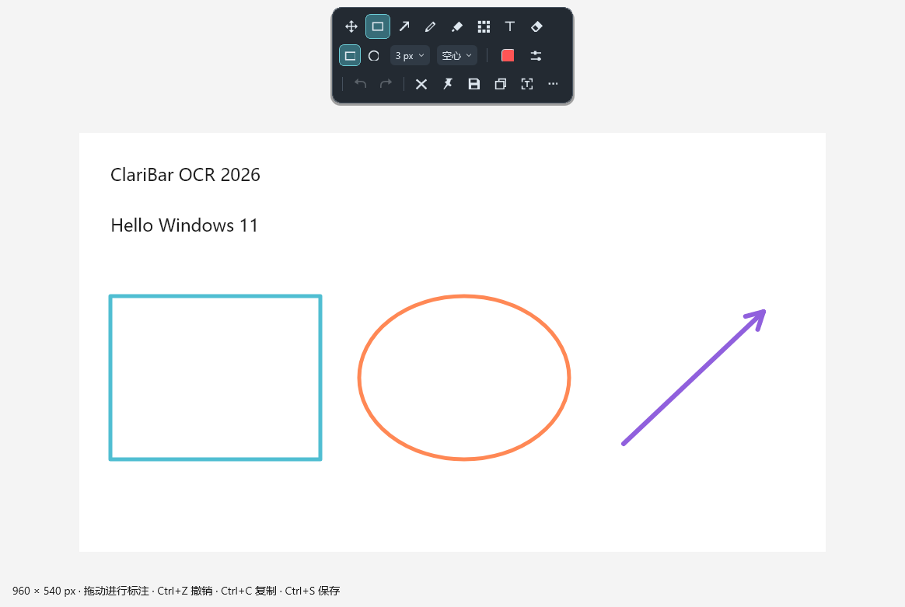
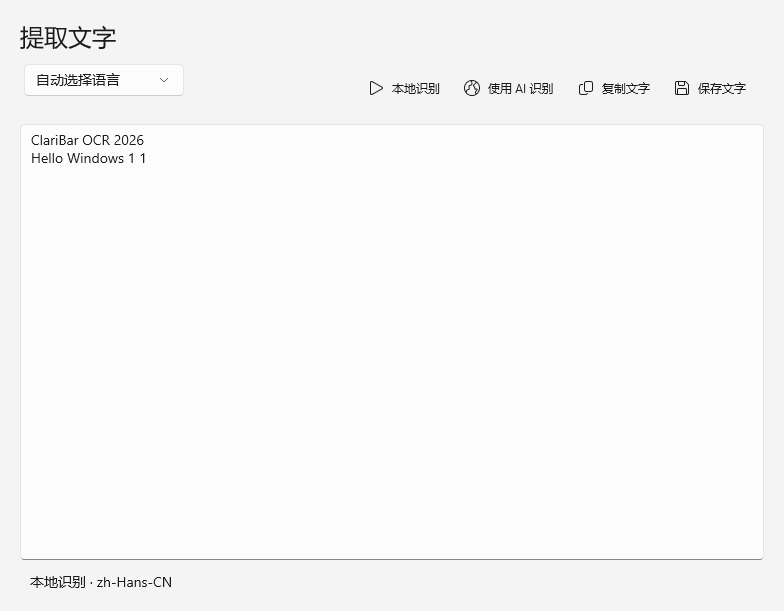
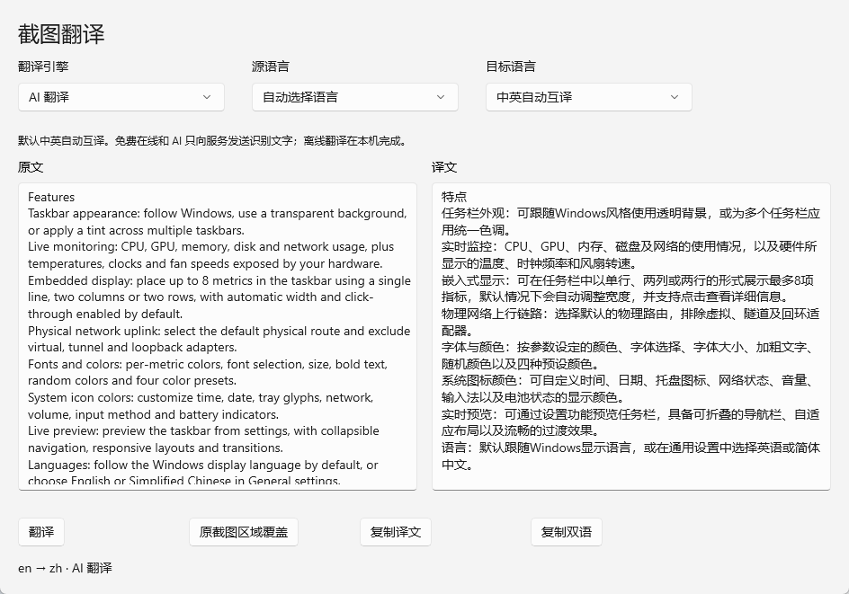
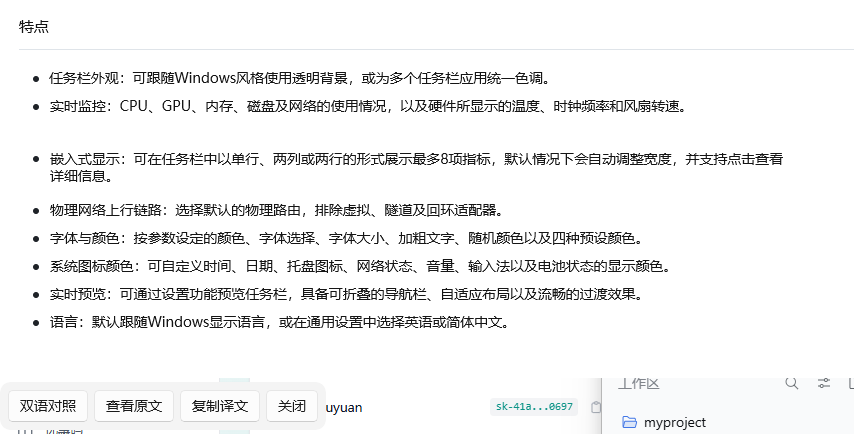

<div align="center">
  
  <h1>澄栏 · ClariBar</h1>
  <p>让 Windows 11 任务栏更通透，让系统状态一目了然。</p>
  <p><a href="https://github.com/Adoubf/ClariBar/releases">下载安装</a> · <a href="https://github.com/Adoubf/ClariBar/issues">问题反馈</a> · <a href="LICENSE">MIT 许可证</a></p>
</div>

[English](README.md) | **简体中文**

ClariBar 是一款面向 Windows 11 的任务栏美化与桌面工具，提供原生设置风格的界面、任务栏透明、内嵌资源监控、文字和系统图标配色，以及屏幕取色、截图、贴图、文字识别与截图翻译。

**最新版本：**[ClariBar 0.83 · Windows 11 x64](https://github.com/Adoubf/ClariBar/releases/tag/v0.83)。

## 界面展示

以下为程序实际界面，点击图片可查看大图。

| 概览 · 浅色 | 概览 · 深色 |
| --- | --- |
|  |  |

| 资源监控 | 文字与图标 |
| --- | --- |
|  |  |

| 桌面工具 | 颜色编辑器 |
| --- | --- |
|  |  |

| 截图编辑器 | OCR 文字识别 |
| --- | --- |
|  |  |

| 截图翻译 · 双语对照 | 截图翻译 · 区域覆盖 |
| --- | --- |
|  |  |

## 功能

- **任务栏外观**：跟随系统、全透明或半透明着色，支持多显示器任务栏。
- **实时监控**：查看 CPU、GPU、内存、磁盘和网络状态，以及硬件支持的温度、频率和风扇转速。
- **内嵌显示**：将常用指标嵌入任务栏，支持单行、双栏和双行布局，默认自动适应文字宽度并穿透鼠标。
- **网络选择**：根据默认物理出口读取上下载速度，过滤虚拟、隧道和回环网卡。
- **文字与配色**：逐项调整颜色，选择字体、字号和加粗，提供随机配色及四套预设方案。
- **系统图标配色**：分别调整时间、日期、托盘、网络、音量、输入法和电池的文字或字形颜色。
- **实时预览**：在设置页查看任务栏效果；支持折叠导航、自适应布局和过渡动画。
- **语言切换**：默认跟随 Windows 显示语言，也可在“通用设置”手动选择 English 或简体中文。
- **屏幕取色**：桌面实时刷新，保留正常鼠标指针，颜色方块跟随鼠标，放大镜显示当前悬浮区域。可编辑颜色并复制 HEX / RGB / HSL，提供明暗色阶和颜色历史；同一编辑器也可调整任务栏和监控指标的颜色。
- **截图**：八方向选区调整、窗口与界面元素识别、选区旁原位标注，支持延时、自定义尺寸、白板、鼠标指针、重复上次区域与成功截图历史。可保存 PNG、JPEG、BMP、WebP，另有快速保存操作。
- **标注**：矩形、椭圆、直线、折线、箭头、画笔、记号笔、马赛克、高斯模糊、橡皮擦，以及字体样式和文字旋转，支持撤销、重做和清空。
- **贴图**：剪贴板图片、文本、基础 HTML、色值和文件均可转换为置顶图片，支持缩放、旋转、翻转、透明度、缩略图、鼠标穿透、分组、关闭恢复与重启还原；GIF 支持播放和逐帧查看。
- **文字识别与统一 AI 配置**：默认使用已安装的 Windows OCR 语言，也可通过本机、内网或远程 HTTP/HTTPS 服务接入 OCR、VL 或通用多模态模型。识别与翻译共用连接和密钥，分别填写模型 ID，并支持测试连接。
- **截图翻译**：按 **Ctrl + Alt + A** 框选，支持双语对照弹窗和原截图区域覆盖显示，自动将中文译为英文、英文译为中文。默认使用免费在线接口，离线模型仅在主动勾选后下载，AI 还支持手动指定其他目标语言。

## 下载与安装

1. 从 [Releases](https://github.com/Adoubf/ClariBar/releases/tag/v0.83) 下载 [ClariBar-Setup-0.83-x64.exe](https://github.com/Adoubf/ClariBar/releases/download/v0.83/ClariBar-Setup-0.83-x64.exe)。
2. 运行安装程序，按需选择程序和运行数据的保存位置。
3. 启动 ClariBar，在“任务栏外观”和“资源监控”中配置显示效果。

系统要求：**Windows 11 x64**。安装包自带 .NET 和 Windows App SDK 运行库，普通用户无需安装开发环境。

读取部分 CPU、主板温度和风扇数据需要在应用内授权硬件访问；安装向导可选安装官方 PawnIO 组件。升级保留已有设置，卸载保留个人运行数据。

当前版本为未签名的安装预览版。Release 同时提供 SHA-256 校验文件，可使用 PowerShell 的 `Get-FileHash` 核对下载文件。

**0.83** 修复了从托盘恢复设置后关闭按钮持续发红，以及退出时延迟更新标题栏导致的异常；同时包含中英自动互译、HY-MT 适配、首次硬件读取等待时间优化和窄窗口离线模型设置换行。升级会保留已有设置、自定义快捷键、密钥和历史记录。

## 使用

1. 在“任务栏外观”中选择背景样式并开启任务栏内嵌监控。
2. 在“资源监控”中筛选并固定需要显示的指标，最多支持 8 项。
3. 在“文字与图标”中调整布局、配色、字体和字号，通过预览查看效果。
4. 关闭设置窗口后，应用默认继续驻留托盘；从托盘彻底退出或点击“全部还原”可恢复系统外观。

工具栏的“帮助”可查看操作说明；`Ctrl+B` 折叠导航，`Ctrl+F` 查找传感器。

从设置或托盘菜单打开桌面工具，在“桌面工具”页可修改或禁用全局快捷键：

| 默认快捷键 | 功能 |
| --- | --- |
| `F1` | 截取窗口或选定区域 |
| `Ctrl+Alt+C` | 屏幕取色 |
| `F3` | 将剪贴板图片贴图置顶 |
| `Ctrl+Alt+O` | 框选区域并提取文字 |
| `Ctrl+Alt+A` | 框选区域并翻译文字 |
| 未分配 | 鼠标穿透（可选） |
| 未分配 | 延时截图（可选） |
| `Shift+F3` | 显示或隐藏全部贴图 |

截图和贴图快捷键与 Snipaste 对齐。切换到 ClariBar 使用相同按键前，请退出 Snipaste 或禁用其全局快捷键。Windows 错误 1409 表示快捷键已被占用，设置页会说明冲突并提供“重新注册”按钮。单项快捷键留空即可停用，也可点击“使用 Snipaste 快捷键”重新应用预设。升级时会保留已有的自定义快捷键。

截图时松开鼠标仍保留选区，可以继续调整和标注：

| 操作 | 按键 |
| --- | --- |
| 窗口 / 界面元素识别 | 选择前按 `Tab` |
| 移动 / 扩大 / 缩小选区 | 方向键 / `Ctrl+方向键` / `Shift+方向键` |
| 逐像素移动鼠标 | `W`、`A`、`S`、`D` |
| 拖动时移动整个选区 | 按住 `Space` |
| 放大镜 / 切换色值格式 / 复制色值 | `Alt` / `Shift` / `C` |
| 复制并完成 / 贴图 | `Enter` 或双击 / `Ctrl+T` 或中键 |
| 另存为 / 快速保存 | `Ctrl+S` / `Ctrl+Shift+S` |
| 上次区域 / 截图历史 | `R` / `,` 和 `.` |
| 显示或隐藏标注工具栏 | `Space` |
| 撤销 / 重做 / 清空标注 | `Ctrl+Z` / `Ctrl+Y` / `Ctrl+Shift+Z` |
| 结束当前形状 / 重选区域 | 右键 |

贴图支持拖动移动、滚轮缩放、`Ctrl+滚轮` 调整透明度，按住 `Shift` 拖动可吸附其他窗口。`1` / `2` 旋转，`3` / `4` 翻转，中键恢复原大小与不透明度，`Shift+双击` 切换缩略图，`Space` 原位标注。GIF 中 `1` / `2` 逐帧查看，`Shift+滚轮` 调整播放速度。右键菜单提供图片操作，也可打开 Windows 打印对话框。

贴图标注工具栏使用独立悬浮窗口，紧贴图片下方；下方空间不足时自动放到上方。图片和工具栏没有额外的系统外框，自定义颜色和样式面板可以完整展开到工具栏窗口之外。置顶按钮显示当前贴图状态，复制按钮使用普通操作样式。关闭工具栏后恢复原位置、原大小的贴图。箭头必须拖拽绘制，拖动中实时预览完整箭头，单击不创建标注；画笔类工具连续绘制新笔画，不显示对象缩放点。

默认取色完成后仅打开颜色编辑器；从编辑器再次取色会返回同一个窗口。在任务栏或监控指标的配色设置中取色，则返回发起取色的设置页面。

`Esc` 或双击会可恢复地关闭贴图；剪贴板内容未改变时再次贴图可恢复。`Shift+Esc` 销毁贴图。“隐藏全部”保留打开状态，默认在程序重启后还原贴图和分组。更多选项位于“桌面工具”的截图和贴图偏好设置中。HTML 使用本地渲染器支持常见文字样式，不加载网页内容。

颜色编辑器参照 PowerToys 布局：横向颜色历史、竖向相近色阶、紧凑的 HEX/RGB/HSL/HSV 格式卡片，以及按需打开的 HSV/RGB/HEX 精调面板。点击卡片复制色值，右键历史颜色可删除或导出；齿轮按钮可设置启动行为、鼠标操作、默认复制格式，并添加、编辑和排列自定义格式。取色期间不冻结桌面、不替换鼠标指针，颜色预览跟随鼠标移动，滚轮打开或调整当前悬浮区域的实时放大镜。默认左键复制并打开编辑器、中键复制后关闭、右键取消。也支持自行绑定 `Win+Shift+C`。

在 **桌面工具 → 截图与文字识别 → 默认识别方式** 中选择本地识别或 AI 文字识别。截图、贴图和快捷键打开的识别窗口会自动使用所选方式；选择 AI 后，当前选区会发送到已配置的模型服务。新安装默认使用本地识别。

本地 OCR 使用 Windows 语言组件，无需额外下载模型。如果未安装 OCR 语言，可在 Windows 语言设置中添加。截图和识别文字保存到“桌面工具”中选择的目录。

可选 AI OCR 支持本机、内网和远程的 **HTTP 或 HTTPS** 服务，可自动检测端点，或手动选择以下接口格式：

| 端点类型 | 标准接口后缀 |
| --- | --- |
| OpenAI Chat Completions | `/v1/chat/completions` |
| OpenAI Responses | `/v1/responses` |
| Anthropic Messages | `/v1/messages` |
| Gemini GenerateContent | `/v1beta/models/{model}:generateContent` |

地址可填写服务根地址、`/v1`、`/v1beta` 或完整 API 端点，设置中会预览实际请求地址。本机及内网服务使用直连；HTTPS 保留正常的证书校验，内网服务也需使用受信任的证书。

模型 ID 可以自由填写，支持通过上述接口接入 **PaddleOCR-VL、DeepSeek-OCR 等 OCR 模型、VL 模型和通用多模态模型**。自动模式会为 PaddleOCR-VL 和 DeepSeek-OCR 使用其文档中的 OCR 提示词，也可设置自定义提示词和请求超时。部署的服务需支持所选接口格式的图像输入。

点击 **测试连接** 会使用当前输入发送内置示例图，显示接口、模型、耗时及识别文字；同时区分识别成功、接口已连接但示例文字未识别，以及鉴权、地址、网络、证书和超时错误。测试不会保存修改，确认后可点击 **保存 AI 设置**。密钥使用当前 Windows 账户加密，诊断导出不包含密钥。

### 截图翻译

按 **Ctrl + Alt + A** 后点击窗口或拖动框选。在 **桌面工具 → 截图翻译** 中选择默认引擎与显示方式。双语对照窗口并排显示原文和译文，窄窗口自动改为上下排列；覆盖模式在原截图位置显示译文，附近工具栏可查看原文、复制、关闭或返回双语对照。切换视图会复用结果，不会重复请求。目标语言默认使用**中英自动互译**：中文截图译为英文，英文截图译为中文，每次截图都会重新判断方向。也可手动指定目标语言，AI 支持其他语言。

- **免费在线（默认）**：使用 MyMemory，无需密钥或模型下载，只发送识别到的文字。其当前匿名免费额度为[每天 5,000 字符](https://mymemory.translated.net/doc/usagelimits.php)，网络和额度错误会直接显示。
- **可选离线**：CPU 中英双向翻译。只有勾选下载选项后才会下载约 190 MB 的模型和独立运行环境，存入应用的数据／缓存目录。默认不自动下载，支持取消、重试和 SHA-256 校验。
- **AI 翻译**：在 **AI 配置** 中增加**翻译模型 ID**。文字识别和翻译共用已有服务地址、协议、密钥及超时；翻译只发送识别文字，普通文本模型即可使用，也可用多模态模型。目标语言可输入代码或名称，由所选模型决定支持范围。可通过 **测试模型 → AI 翻译 → 测试连接** 验证内置短文本。

翻译首先使用已安装的 Windows OCR 语言提取文字，自动模式识别英文时会优先使用已安装的英文识别器。缺少组件或引擎不可用时会明确提示，不会自动改用其他服务。

AI 翻译会先把截图中自动换行的文字合并为完整段落。**腾讯 HY-MT / Hunyuan-MT** 模型使用其[官方翻译提示词](https://huggingface.co/tencent/Hy-MT2-7B)，逐段接收纯文本译文。通用模型使用结构化返回；如果模型合并了分块，则按段重试。两种方式均保留原文位置，供覆盖显示使用；翻译失败时也会保留已识别的原文。

也可通过命令行触发正在运行的实例：

```powershell
ClariBar.exe --capture
ClariBar.exe --pick-color
ClariBar.exe --pin
ClariBar.exe --ocr
ClariBar.exe --translate
ClariBar.exe --hide-pins
ClariBar.exe --delayed-capture
ClariBar.exe --quit
```

## 版本规则

新增功能调整第一位小数，例如 `0.7` → `0.8`；优化和修复调整第二位小数，例如 `0.71` → `0.72`。当前测试版为 **0.83**。程序、构建脚本和安装包统一读取 `Version.props` 中的版本信息。

## 从源码构建

### 开发环境

- Windows 11 x64
- Visual Studio 或 Build Tools，安装“使用 C++ 的桌面开发”和 Windows SDK 10.0.26100 或更高版本
- .NET SDK 10.0.403 或同一主版本的更新 SDK
- CMake 3.25 或更高版本、Ninja、Git
- 打包安装程序时需要 Inno Setup 7.1，以及官方 [PawnIO 安装程序](https://github.com/namazso/PawnIO.Setup/releases)

### 构建和运行

```powershell
git clone https://github.com/Adoubf/ClariBar.git
cd ClariBar
.\scripts\build.ps1 -Check
.\scripts\run.ps1 -Development
```

也可以在 Visual Studio 中打开 `ClariBar.slnx`。默认构建、缓存和产物保存在仓库的 `.build/` 目录；设置 `CLARIBAR_ROOT` 环境变量可以使用其他目录。脚本优先使用该目录下的便携工具，也支持系统开发环境。

### 生成安装包

```powershell
.\scripts\package.ps1 -PawnIOInstaller ".\PawnIO_setup.exe"
```

脚本完成构建、自包含发布和安装包生成。Inno Setup 可位于开发目录或标准安装目录，也可通过 `-InnoCompiler` 指定 `ISCC.exe`。生成的安装包位于开发目录下的 `artifacts/ClariBar/releases/`。

## 项目结构

| 目录 | 内容 |
| --- | --- |
| `src/ClariBar.App` | C# / WinUI 3 设置界面 |
| `src/ClariBar.Core` | 配置、数据模型、指标筛选和中文标签 |
| `src/ClariBar.SensorBroker` | 独立硬件采集进程 |
| `src/ClariBar.Native` | C++ 原生窗口、系统指标和任务栏桥接 |
| `src/ClariBar.ExplorerTap` | C++ / WinRT 任务栏适配 |
| `assets/branding` | 应用图标和安装器素材 |
| `installer` | 安装向导与引导程序 |
| `scripts` | 构建、打包与验证脚本 |
| `tests` | 核心功能及任务栏集成检查 |
| `licenses` | 第三方许可证 |

## 兼容性说明

- 任务栏适配依赖 Windows 11 内部控件，Windows 更新或其他任务栏修改工具可能影响兼容性。
- 温度、频率和风扇数据取决于硬件、驱动和访问权限；没有读数的通道不会以其他传感器的数据替代。
- 系统配色覆盖支持的文字、字形和矢量图标，第三方托盘程序的彩色位图暂不重绘。
- 应用只读取硬件信息，不控制风扇转速、电压或功率。

## 反馈与贡献

欢迎通过[错误报告表单](https://github.com/Adoubf/ClariBar/issues/new?template=02-bug-report.zh-CN.yml)或[功能建议表单](https://github.com/Adoubf/ClariBar/issues/new?template=04-feature-request.zh-CN.yml)提交反馈，或通过 Pull Request 参与改进。Issue 表单同时提供英文和中文版本。

错误报告必须填写 ClariBar 版本、Windows 版本及内部版本号、受影响功能、复现步骤、预期结果与实际结果。硬件信息、显示器设置、截图和日志可选；上传前请遮挡个人路径、账号及令牌等敏感信息。

## 作者与支持

作者：**Haoyue**
邮箱：[mosaryalex@gmail.com](mailto:mosaryalex@gmail.com)

感谢每一位使用、反馈和贡献的朋友。赞助事宜请通过邮箱联系；如希望在软件关于页面署名致谢，请注明可以公开展示的名称。

## 许可证

ClariBar 原创代码和品牌素材采用 [MIT 许可证](LICENSE)。第三方组件遵循各自许可证，详见 [THIRD-PARTY-NOTICES.md](THIRD-PARTY-NOTICES.md)。
